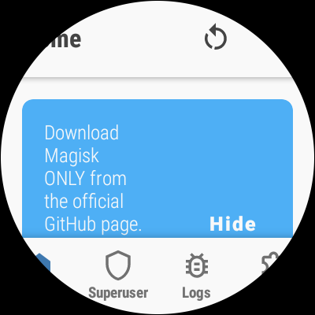
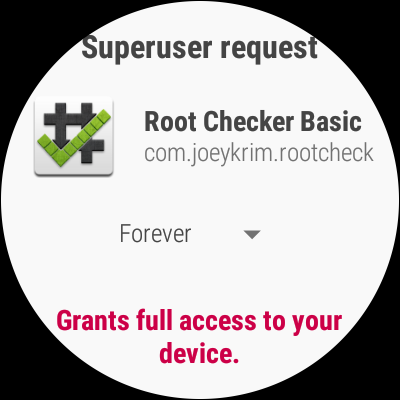
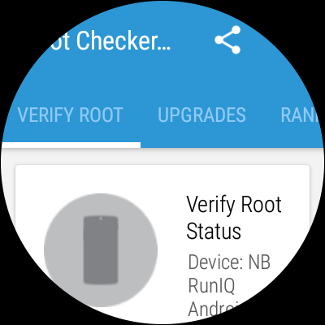

# 🧸 Root del NBRiq — guía fácil (para dummies)

**Root + optimización de un reloj New Balance RunIQ** (Intel Atom x86, Wear OS 2.0 /
Android 7.1.1). Aquí está todo lo que hice en mi reloj, contado para que lo puedas repetir
sin ser ingeniero.

> 🔧 **¿Quieres el *por qué* técnico, los hallazgos y las trampas?**
> → [**README-TECNICO.md**](README-TECNICO.md) y la carpeta [`docs/`](docs/).

---

> ## ⚠️ ANTES DE EMPEZAR: esto puede brikear tu reloj
> - El desbloqueo del bootloader **borra TODO** el reloj (vuelve a estado de fábrica).
> - Si flasheas una imagen que no es la de tu versión, el reloj **no arranca**.
> - Meter root **anula la garantía** y baja la seguridad del sistema.
> - Lo hice en **mi** dispositivo y lo comparto **sin garantía de ningún tipo**. Si algo se
>   rompe, **es tu responsabilidad**: yo no respondo de relojes bloqueados, datos perdidos ni
>   daños de ningún tipo.
>
> 👉 Lee **[DISCLAIMER.md](DISCLAIMER.md)** (riesgos, qué puede salir mal y cómo reducirlo).
> **Si no entiendes un paso, no lo ejecutes.**

---

## ¿Mi reloj sirve para esto?

Es específico del **New Balance RunIQ** (`shasta`). Compruébalo con el reloj conectado:

```bash
adb shell getprop ro.product.device     # debe decir: shasta
adb shell getprop ro.build.version.sdk  # debe decir: 25   (Android 7.1.1)
adb shell getprop ro.product.cpu.abi    # debe decir: x86
```

| dato | valor |
|---|---|
| modelo | NB RunIQ (New Balance RunIQ) |
| nombre interno | `shasta` (board `robby`) |
| procesador | Intel Atom **x86** (no ARM) |
| sistema | Android 7.1.1 (API 25) = Wear OS 2.0 |
| firmware de referencia | `NWD1.171016.002` |
| bootloader | `SHASTA-03.54` |
| RAM | 455 MB |
| en mi reloj | USB `BIB7UX7D9PBGSE` · Wi-Fi `10.0.0.132:5555` |

Si tu firmware es otro, **las imágenes de `ota/` pueden no servirte** (el procedimiento sí).

## ¿Cómo se ve el resultado?

| Magisk instalado | Pestaña *Superuser* | Petición de root | Comprobador |
|---|---|---|---|
|  |  |  |  |

Y lo que sale por consola cuando el root está bien:

```console
$ adb shell "su -c 'magisk -v; id'"
30.7:MAGISK:R
uid=0(root) gid=0(root) groups=0(root) context=u:r:magisk:s0
```

## Lo que necesitas

1. Un ordenador con **`adb`** y **`fastboot`** (Android Platform Tools) y un cable USB.
2. El APK de **Magisk v30.7** (`magisk/Magisk-v30.7.apk`, ya está en el repo).
3. Las **imágenes de boot** de tu firmware (`ota/`, ya están en el repo) — sobre todo
   `boot-stock.img` para volver atrás.
4. Paciencia: el desbloqueo borra el reloj y hay que volver a configurarlo.

---

## Paso a paso

### 0. Conecta el reloj

```bash
adb devices -l          # debe aparecer tu reloj (por USB o por Wi-Fi)
adb connect 10.0.0.132:5555    # si prefieres Wi-Fi (acepta el aviso en el reloj)
```

> 💡 Si `adb devices` sale vacío: activa en el reloj **Ajustes → Sistema → Información**
> → toca *Número de compilación* 7 veces → **Opciones de desarrollador → Depuración ADB**.

### 1. Desbloquea el bootloader ⚠️ **esto borra todo**

```bash
adb reboot bootloader
fastboot getvar device_state          # locked = aún bloqueado
fastboot flashing unlock              # acepta en el reloj con los botones
fastboot reboot
```

Después hay que **volver a configurar el reloj** (emparejar con el móvil) y **activar otra
vez la depuración ADB** (paso 0).

### 2. Ponle Magisk (el root)

```bash
adb reboot bootloader
fastboot boot  ota/boot-magisk.img    # prueba en RAM: NO escribe nada (si algo va mal, reinicias y listo)
fastboot flash boot ota/boot-magisk.img
fastboot reboot
adb install -r magisk/Magisk-v30.7.apk
```

> ⚠️ `boot-magisk-slim.img` **no arranca** (lo probamos): usa `boot-magisk.img`.

### 3. Comprueba que el root funciona

```bash
adb shell "su -c 'magisk -v; id'"
# 30.7:MAGISK:R
# uid=0(root) gid=0(root) groups=0(root) context=u:r:magisk:s0
```

Si además quieres concederle root a una app sin pelear con el diálogo de la pantalla:

```bash
./scripts/grant-su.sh --list            # ver quién tiene root
./scripts/grant-su.sh com.mi.app        # concedérselo (reinicia para que surta efecto)
```

Y para ver el estado de todo de un vistazo:

```bash
./scripts/root-check.sh
```

### 4. Quita la grasa (opcional, muy recomendable)

El reloj tiene 455 MB de RAM y va justo. Todo es **reversible**:

```bash
./scripts/debloat.sh status    # qué está desactivado y cuánta memoria libre hay
./scripts/debloat.sh apply     # desactiva apps de Google que no usas + animaciones
./scripts/debloat.sh restore   # vuelve a como estaba de fábrica
```

### 5. Extras (opcional)

```bash
./scripts/random-serial.sh     # que el reloj no muestre su serial real (privacidad)
./scripts/battery.sh           # informe de batería: salud y qué la gasta
./scripts/wearapp.sh install   # mi esfera propia estilo Pixel Watch (wearapp/)
```

### 6. Volver atrás (quitar el root)

```bash
adb reboot bootloader
fastboot flash boot ota/boot-stock.img     # boot de fábrica
fastboot reboot
```

> ⚠️ **Nunca** hagas `fastboot flashing lock` con Magisk dentro: el reloj no volvería a arrancar.

---

## Si algo va mal

| Lo que ves | Qué pasa | Qué hacer |
|---|---|---|
| No arranca, pero entra en `fastboot` | El `boot` no es el de tu firmware | `fastboot flash boot ota/boot-stock.img` |
| Pantalla negra y nada de `fastboot` | Brick duro | Solo queda servicio técnico (y sin garantía). Por eso el aviso de arriba. |
| `adb devices` vacío tras el unlock | El desbloqueo apagó la depuración | Vuelve a activarla (paso 0) |
| `su` no responde / `Illegal instruction` | `magiskd` se cayó | Reinicia el reloj |
| `adb: device offline` a cada rato | Wear OS apaga la Wi-Fi al dormirse | Despierta el reloj (`input keyevent 224`) o usa USB |
| El reloj se reinicia solo | **No es el root ni las apps**: es el watchdog del kernel de este ROM | `./scripts/diag-reboot.sh`… (está en el otro repo: [Sp0tiold-X86](https://github.com/AlbenVarg/Sp0tiold-X86)) |
| Quiero volver a fábrica | — | Paso 6 (boot stock) + `./scripts/debloat.sh restore` |

## Preguntas tontas (con respuesta honesta)

**¿Pierdo todo?** Sí, el desbloqueo borra el reloj. Haz copia antes (`adb pull /sdcard`).

**¿Es peligroso?** Tiene riesgo real de brick. Se reduce probando con `fastboot boot` antes de
`fastboot flash`, y teniendo a mano `boot-stock.img`.

**¿Sirve para otro reloj?** No. Es para el RunIQ (`shasta`, Intel x86). En otro reloj, los
comandos pueden ser parecidos pero **las imágenes no**.

**¿Me pueden banear de algo?** No hay nada de cuentas ni licencias; es tu reloj.

**¿Necesito el móvil?** Para configurarlo tras el wipe sí (emparejarlo con Wear OS). Después no.

**¿Se puede actualizar a Wear OS 3?** No: Google nunca publicó Wear OS 3 para x86. El techo es
Wear OS 2.0 / Android 7.1.1, que es donde lo hemos dejado.

**¿Puedo bloquear otra vez el bootloader?** Solo con `boot`/`system` de fábrica. Con Magisk
dentro, el reloj no arrancaría.

## Scripts

| Script | Para qué |
|---|---|
| `scripts/nbriq.sh` | estado, entrar al bootloader, unlock/relock, reiniciar |
| `scripts/root-check.sh` | ver de un vistazo si hay root y cómo está todo |
| `scripts/grant-su.sh` | dar root a una app sin tocar la pantalla |
| `scripts/debloat.sh` | quitar apps de fondo (reversible) |
| `scripts/random-serial.sh` | cambiar el serial que muestra el reloj |
| `scripts/battery.sh` | salud de la batería y consumos |
| `scripts/wearapp.sh` | compilar/instalar mi esfera propia |
| `scripts/fix-selinux-data.sh` | permitir que `su` escriba en `/data/data` (avanzado) |

---

## El detalle técnico

- [**README-TECNICO.md**](README-TECNICO.md) — guía completa: particiones, hashes, SELinux,
  debloat, imágenes de boot, qué no está en git y todas las trampas.
- [`docs/SESION-COMPLETA.md`](docs/SESION-COMPLETA.md) — la bitácora íntegra de la sesión.
- [`docs/SELINUX.md`](docs/SELINUX.md) — por qué `su` no podía escribir en `/data/data`.
- [`DISCLAIMER.md`](DISCLAIMER.md) — el aviso legal de verdad.
